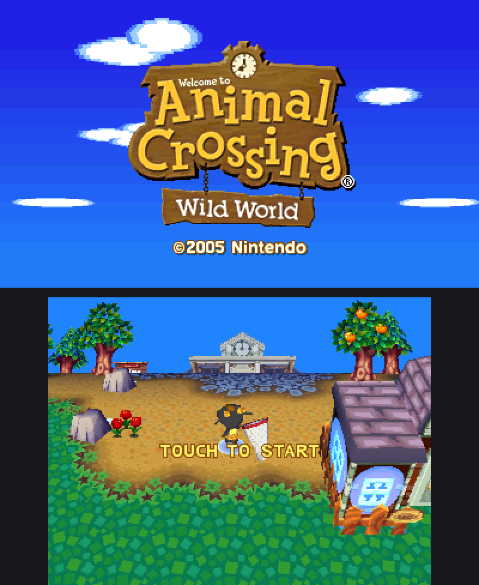
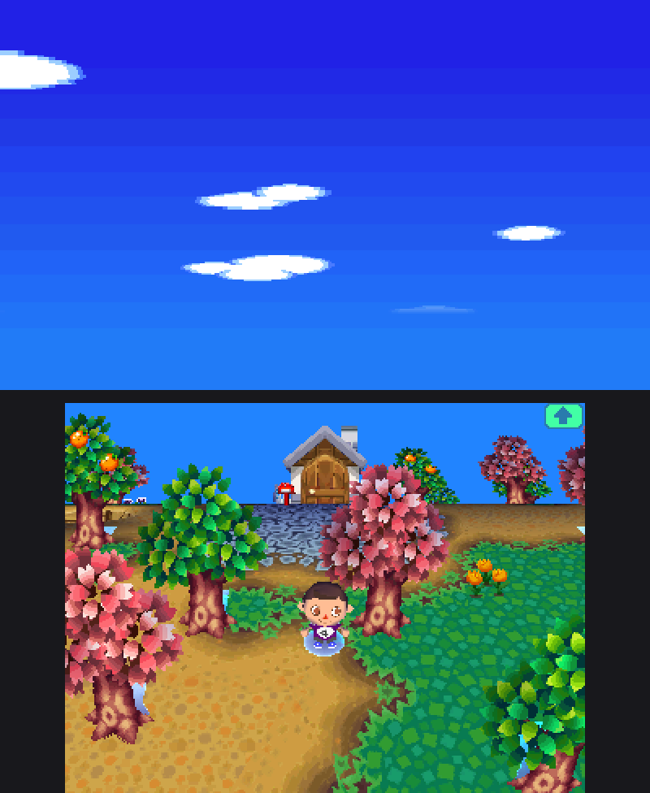
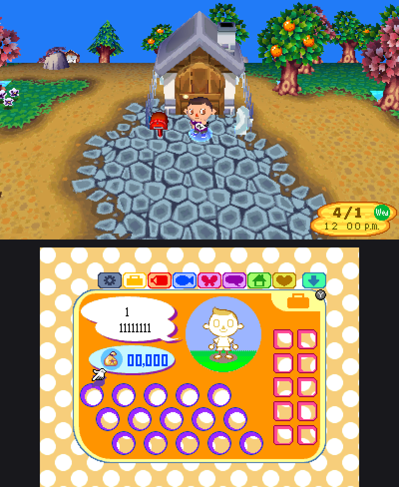
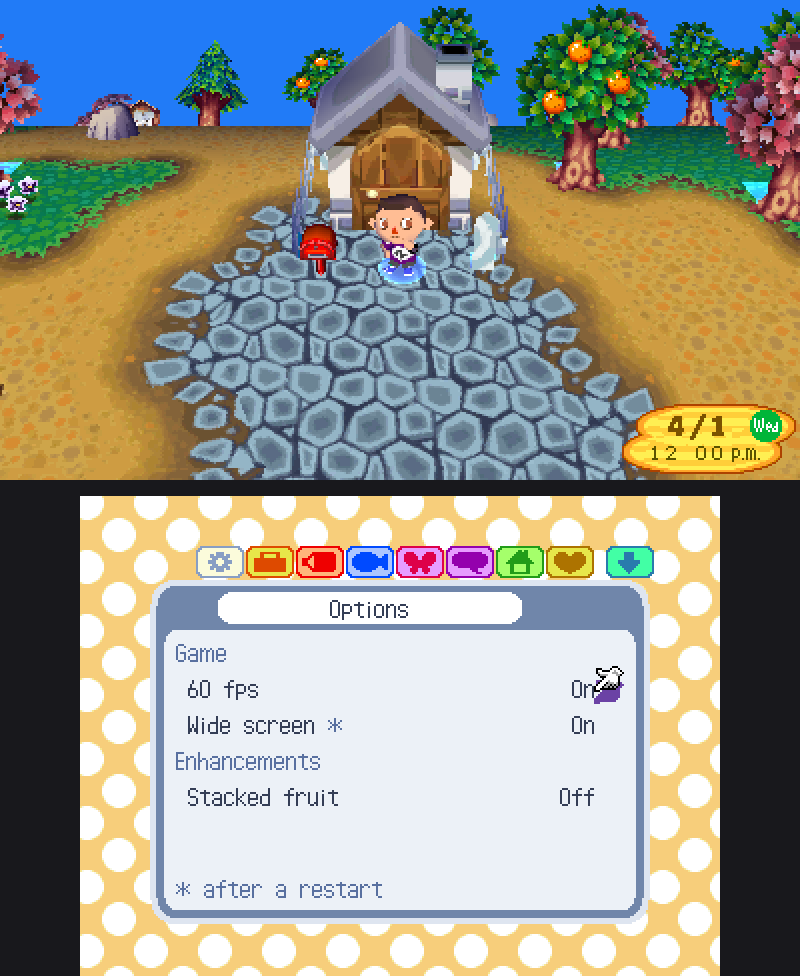
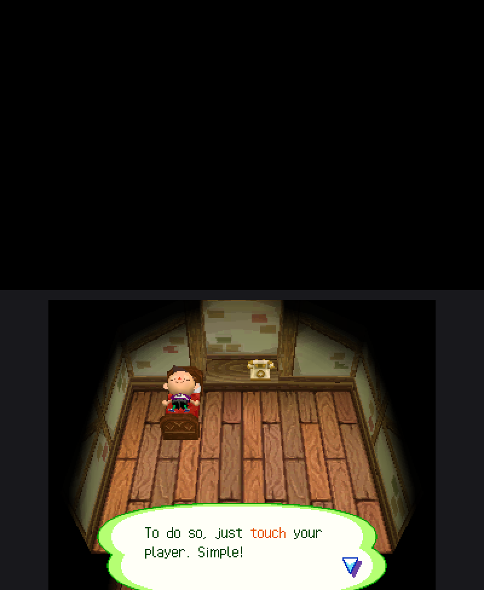

# Animal Crossing: Wild World for the Nintendo 3DS

Animal Crossing: Wild World (Nintendo DS) as a native Nintendo 3DS program. The game's code comes from a complete
decompilation and is compiled for the 3DS's ARM11, with the DS's hardware rebuilt on the 3DS's own: the 3D on its
GPU, the sound on its DSP, the save and the ROM on the SD card. It doesn't use an emulator, and it does what a DS
can't: wide screens, 60 frames a second and an options page in the game's own menu. You need your own copy of the
game.

<p align="center">
  
  
  
</p>

## Features

- **Wide screens.** The town is drawn across the 3DS's full 400 × 240 top and 320 × 240 bottom screens instead of the
  DS's 256 × 192, and the game's interface moves to the screens' edges.
- **60 fps as the target.** The game draws a 3D picture every third frame; the port draws the pictures in between.
  60 fps is not reached everywhere yet.
- **Analog Circle Pad.** The player walks in any direction, not only the D-pad's eight, and as fast as the Circle
  Pad is tilted.
- **Native.** The decompiled game runs as ARM code, and the 3D goes straight to the 3DS's GPU (PICA200).
- **Options page.** A new tab in the pause menu, left of the pockets: L from the pockets, or touch its button.
  Settings are saved to `acww.cfg`.
- **Stacked fruit** (off by default). Up to 9 of a fruit in one pocket slot.
- **Other languages.** English, French, German, Italian or Spanish text, taken from your copy of the European
  version. Only German has been tested so far.

So far the port has only been tested on a New Nintendo 3DS (and in the Azahar emulator); how it runs on an original
3DS or 2DS is unknown.

<p align="center">
  
  
</p>

## Install

You need a 3DS that runs homebrew (the Homebrew Launcher) and your own dump of the game:

| Version     | Game code | SHA-1                                      |
| ----------- | --------- | ------------------------------------------ |
| USA (Rev 1) | `ADME`    | `77fde3e30e1e6068395d1f96ea63be569b61c351` |

1. Build `acww.3dsx` yourself (see [Build](#build)). No ready-made `.3dsx` is provided: it would contain the
   game's compiled code.
2. Copy `acww.3dsx` and your ROM, renamed to `game.nds`, to `sd:/3ds/acww/`.
3. Start it from the Homebrew Launcher.

The sound needs the 3DS's DSP firmware at `sd:/3ds/dspfirm.cdc`, which is not included: dump it from your own
console with the DSP1 homebrew. Without it the game runs silently.

The game saves to `sd:/3ds/acww/game.sav`, and the program's log goes to `log.txt` in the same folder.

### Controls

The 3DS's buttons are the DS's, and the touch screen is the DS's. The Circle Pad walks with any angle and speed
(`ACWW_ANALOG=0`: as the D-pad).

### Options

The options page writes `sd:/3ds/acww/acww.cfg`, a file of `NAME=value` lines that can also be edited by hand:

| Option                    | Default | Meaning                                                                    |
| ------------------------- | ------- | -------------------------------------------------------------------------- |
| `ACWW_PICA_INTERP`        | `1`     | 60 fps: the pictures between the game's                                    |
| `ACWW_WIDE`               | `1`     | the wide screens (after a restart)                                         |
| `ACWW_STACK_FRUIT`        | `0`     | stacked fruit                                                              |
| `ACWW_ANALOG`             | `1`     | the Circle Pad's angle and tilt (`0`: the D-pad's eight directions)        |
| `ACWW_LANG`               |         | `ENG`, `FRN`, `GER`, `ITA` or `SPN`: that language's text...               |
| `ACWW_LANG_ROM`           |         | ...from the European ROM (`ADMP`) at this path, e.g. `sdmc:/3ds/acww/eur.nds` |

Stacked fruit uses item codes the DS game doesn't have: a save with stacks in it belongs to this port.

## Build

The easiest way needs only [Docker](https://docs.docker.com/get-docker/) and this repository (download it as a ZIP
or clone it). In its folder:

```
sh tools/build_3ds_docker.sh                  # build/host3ds_direct_usa/acww.3dsx
```

It builds in devkitPro's Docker image and doesn't need the ROM. On Windows, run it in WSL.

Without Docker, with [devkitPro](https://devkitpro.org/wiki/Getting_Started)'s 3DS tools (`3ds-dev`, in `/opt/devkitpro`), Python 3
and Ninja:

```
python3 tools/configure_host.py --os 3ds --direct
ninja -f build_host_3ds_direct.ninja          # build/host3ds_direct_usa/acww.3dsx
```

Without `--direct`, the build keeps the PC port's model of the DS hardware instead of the 3DS's own (no wide screens,
no options page): `build_host_3ds.ninja`, `build/host3ds_usa/acww.3dsx`.

## On the PC

The same game code also runs as a PC program (Linux and macOS), with its own 2D and 3D renderers
on the GPU through WebGPU or on the CPU:

```
python3 tools/host_fetch_wgpu.py   # optional: the GPU renderer (downloads wgpu-native)
python3 tools/configure_host.py
ninja -f build_host64.ninja
build/host64_usa/acww path/to/your/game.nds
```

[`docs/host.md`](docs/host.md) describes the runtime, the PC build's controls and options, and how changes are checked.

<p align="center">
  
</p>

## What's here

- `src/`, `include/`: the game's code, decompiled to C and C++, changed toward plain, portable code (it no longer
  rebuilds the original ROM). The 3DS port's changes to it are under `#ifdef N3DS_DIRECT`.
- `modern/host/`: the runtime: the DS's hardware services, the 2D and 3D renderers, the frontends (SDL on the PC,
  `frontend_3ds.c`, `pica_display.c` and `gpu3d/gpu3d_pica.c` on the 3DS).
- `modern/ds/`: the runtime's game-side parts: the overlays, the second ROM for the languages.
- `tools/configure_host.py`: every build's setup.

## Credits

This builds on [acww-decomp](https://github.com/7ucina/acww-decomp) by Lucina and its contributors: the decompilation
and the PC port this 3DS port started from. The matching decompilation, which rebuilds the original ROM byte for
byte, is at the `matching` tag ([`docs/matching.md`](docs/matching.md)). The 3DS side uses devkitPro's libctru and
citro3d.

## Licence

The project's own work (sources, tools, documentation) is under the MIT licence, see [`LICENSE`](LICENSE). The game
and its ROM belong to Nintendo and are not included; you need your own dump. This project is not affiliated with
Nintendo.

Third-party parts keep their own licences: `tools/ninja_syntax.py` (Apache-2.0) and `tools/host/melonds.patch`
(a patch to melonDS, GPL-3.0; only for the `--oracle` test build, which then is GPL-3.0 as a whole). The 3DS build
links devkitPro's libctru and citro3d, under their licences.
